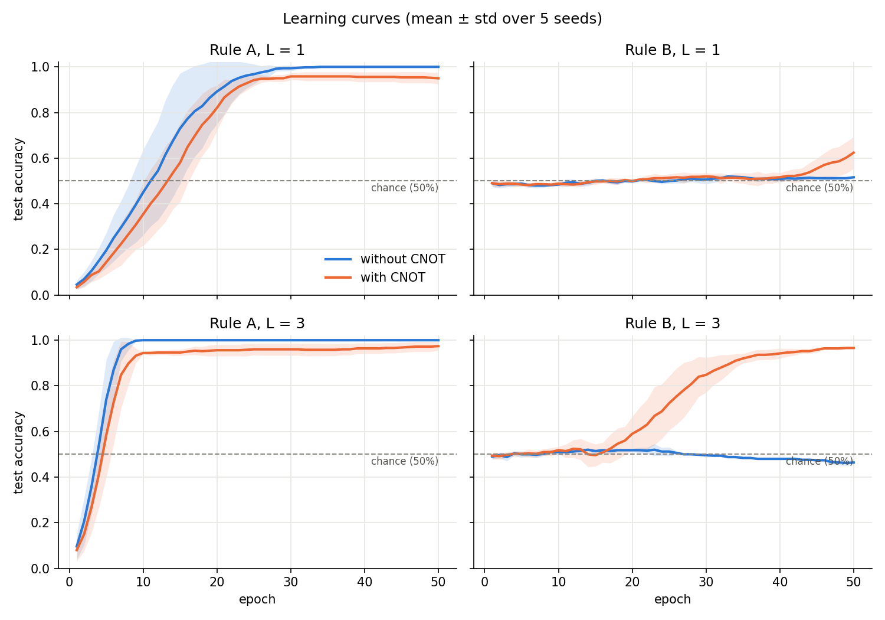
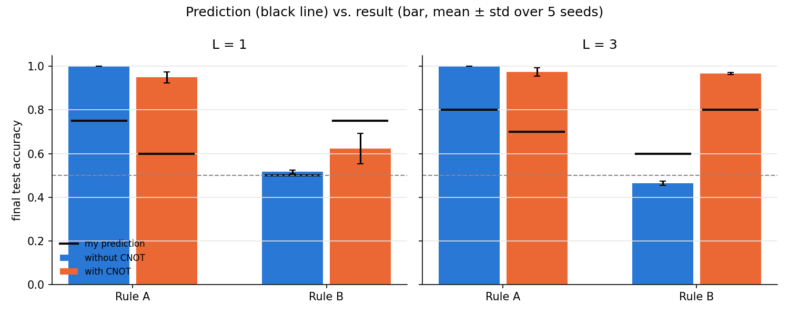

# Challenge 3 — Does the CNOT help? It depends on the data

## 1. Hypothesis (written and committed BEFORE running any experiment)

**Area:** Ansatz (lecture slides 16–22).

**Model:** the variational classifier from slide 31: two qubits, angle encoding RY(x₁), RY(x₂),
ansatz RY(θ₁), RY(θ₂), CNOT(q₀ → q₁), RY(θ₃), RY(θ₄), measure ⟨Z₀⟩, predict ŷ = sign(f).
The "no-CNOT" model is identical except that the CNOT is removed.

**Hypothesis:** The usefulness of the CNOT depends on the *type* of the data.
- If the label depends on only one feature, the CNOT is unnecessary and can even mislead the model,
  because it mixes in information from x₂ that is irrelevant.
- If the label depends on the *combination* of both features, the model without the CNOT cannot see x₂
  at all (only q₀ is measured), so it can only guess; the CNOT model can use both features.

**Datasets** (synthetic, features drawn uniformly from [0, π]):
- **Rule A (single feature):** y = +1 if x₁ > π/2, otherwise y = −1.
- **Rule B (joint features):** y = +1 if x₁ and x₂ are on the same side of π/2, otherwise y = −1.

**Prediction (test accuracy after training):**

|            | without CNOT | with CNOT |
|------------|--------------|-----------|
| Rule A     | ~75 %        | ~60 %     |
| Rule B     | ~50 %        | ~75 %     |

**What counts as "the prediction held":**
1. Ordering: on Rule A, no-CNOT ≥ CNOT; on Rule B, CNOT > no-CNOT, and no-CNOT is close to chance (≤ 60 %).
2. Each measured accuracy is within ±10 percentage points of the predicted value.
   Rationale: with 100 test points and true accuracy ≈ 75 %, the sampling standard deviation is
   √(0.75·0.25/100) ≈ 4.3 points; ±10 ≈ 2 standard deviations, i.e. the range explainable by test-set chance alone.

### 1b. Secondary experiment: depth L = 3

**Idea:** like adding neurons in a classical network, repeating the ansatz block (RY + CNOT + RY, slide 18)
three times should raise accuracy in every case.

**Prediction (test accuracy, L = 3):**

|            | without CNOT | with CNOT |
|------------|--------------|-----------|
| Rule A     | ~80 %        | ~70 %     |
| Rule B     | ~60 %        | ~80 %     |

Note on Rule B without CNOT: q₀ still cannot see x₂, so the model has no real way to learn the rule;
any accuracy above 50 % would come from chance agreement ("a broken clock is right twice a day").

**Held if:** each L = 3 accuracy is ≥ the corresponding L = 1 accuracy, and within ±10 points of the value above.

## 2. Experimental setup (fixed in advance)

- 200 training points, 100 test points per rule; same points for both models.
- Training: parameter-shift gradients (slide 39), MSE loss (slide 34), plain gradient descent, lr = 0.1, 50 epochs (slide 47).
- Initial θ drawn from U(−0.1, 0.1).
- Exact expectation values (StatevectorEstimator); 5 random seeds, report mean ± std.
- Plots: learning curves (loss, accuracy per epoch) and decision maps over the (x₁, x₂) square.

## 3. Results

All numbers: final test accuracy after 50 epochs, mean ± std over 5 seeds (100 test points).
Code: `wyzwanie3.ipynb` (Qiskit 2.6.2, Google Colab).

| L | Rule | without CNOT | with CNOT |
|---|------|--------------|-----------|
| 1 | A    | 100 % ± 0    | 95 % ± 3  |
| 1 | B    | 52 % ± 1     | 62 % ± 7  |
| 3 | A    | 100 % ± 0    | 97 % ± 2  |
| 3 | B    | 46 % ± 1     | 97 % ± 0  |

**Deviation from the plan:** the decision maps listed in section 2 were not produced; the learning curves
and the prediction-vs-result plot turned out to carry the argument. No other setting was changed.

## 4. Did the prediction hold?

**Partly: the direction held, the size did not.**

| Criterion | L = 1 | L = 3 |
|-----------|-------|-------|
| Ordering (A: no-CNOT ≥ CNOT; B: CNOT > no-CNOT, no-CNOT ≤ 60 %) | ✅ held | ✅ held |
| Each value within ±10 points | ❌ 1 of 4 (only B without CNOT) | ❌ 0 of 4 |
| L = 3 ≥ L = 1 in every cell | — | ❌ 3 of 4 (B without CNOT: 46 % < 52 %) |

**What held.** The core claim: the CNOT only matters when the label needs both features.
On Rule B the model without the CNOT stayed at chance (52 %, 46 %) for both depths, because q₀ never sees x₂.
Adding layers did not help it: depth cannot replace the missing connection. With the CNOT the same rule reached 97 % at L = 3.
On Rule A the unnecessary CNOT cost a few points (95–97 % vs 100 %), as predicted in direction.

**Why I was wrong about the numbers.**

1. *Rule A was far easier than I assumed.* Without the CNOT the model is exactly
   f = cos(x₁ + θ₁ + θ₃). Choosing θ₁ + θ₃ = π gives f = −cos x₁, whose sign flips exactly at x₁ = π/2,
   which is the Rule A boundary. The model can represent the rule perfectly; with noise-free labels and
   exact expectation values (no shots), 100 % is expected. I guessed 75 % because I had no intuition for
   how expressive a single rotation is.
2. *Rule B with CNOT at L = 1 was slow, not impossible.* For the normal circuit (control q₀, target q₁) I derived
   and checked numerically:

   f = cos(x₁+θ₁)·cos θ₃ − sin(x₁+θ₁)·sin θ₃·sin(x₂+θ₂)

   The only term containing x₂ is multiplied by sin θ₃. Because θ starts near 0, sin θ₃ ≈ 0 and the model
   initially cannot "hear" x₂. The learning curve stays flat at 50 % for ~40 epochs and is still rising at epoch 50 (62 %).
   With L = 3 there are more parameters to open this path, so the escape happens earlier (~epoch 17) and accuracy reaches 97 %.
   So my L = 1 prediction (75 %) was too high only because training was cut off.
3. *Rule B without CNOT, L = 3: 46 % is not a real drop.* It is chance level; with 100 test points the
   sampling standard deviation is ≈ 5 points, so 46 % and 52 % are both "50 %".

**Lesson.** The CNOT is necessary for joint-feature data in this circuit (q₀ is the only measured qubit, and the CNOT is the
only path from x₂ to it), but being necessary is not sufficient: whether the model actually uses it depends on the
initialisation and on how many epochs it gets.

## 5. What would change if…

…the CNOT direction were reversed (control q₁, target q₀)?

**Prediction (written before running the extra experiment; L = 1, with CNOT, 5 seeds):**
- Rule A: ~50 %. The measured qubit q₀ now depends directly on x₂, which is irrelevant for Rule A and should confuse the model.
- Rule B: ~62 % (same as the normal direction). Rule B depends symmetrically on both features, so the direction of the CNOT should not matter.

**Result (L = 1, with reversed CNOT, 5 seeds):**

| Rule | normal CNOT (q₀ → q₁) | reversed CNOT (q₁ → q₀) | my prediction |
|------|-----------------------|-------------------------|---------------|
| A    | 95 % ± 3              | **98 % ± 0**            | ~50 %         |
| B    | 62 % ± 7              | **98 % ± 0**            | ~62 %         |

Both predictions were wrong. For the reversed circuit (verified against Qiskit):

f = cos θ₃ · cos(x₁+θ₁) · cos(x₂+θ₂) − sin θ₃ · sin(x₁+θ₁)

- **Rule B:** at θ ≈ 0 this is f ≈ cos x₁ · cos x₂, which is positive exactly when x₁ and x₂ are on the same side of π/2,
  i.e. *Rule B itself*. The reversed circuit starts almost at the solution, while the normal circuit starts with the x₂ path closed (sin θ₃ ≈ 0).
- **Rule A:** setting θ₃ = −π/2 removes the x₂ term entirely, so the model can learn to ignore x₂. It was not confused.

**Why my symmetry argument failed:** Rule B is symmetric in x₁ and x₂, but the *circuit* is not, because only q₀ is measured.
With control q₁ and target q₀ the parity (00, 11 → 0; 01, 10 → 1) is written directly onto the measured qubit.
With control q₀ it is written onto q₁, which we never read.

**Takeaway:** in a circuit where only one qubit is measured, it matters not only *whether* there is an entangling gate,
but also *which qubit it targets*. Pointing the CNOT at the measured qubit made both rules easy at L = 1.
